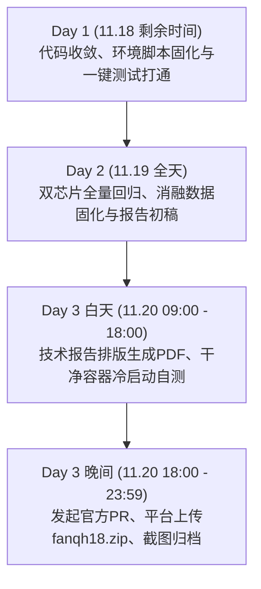

# FlagOS 开放计算全球大赛（赛季二）赛道二：最终交付规范与冲刺执行计划

> **赛题名称**：MiniCPM5-2B 模型推理吞吐性能优化（赛道二）  
> **参赛队伍**：fanqh18（中国科学院数学与系统科学研究院）  
> **官方页面**：https://flagos.io/race-detail-season2?id=539vlt2p  
> **当前日期**：2026 年 11 月 18 日  
> **最终截止**：**2026 年 11 月 20 日 23:59（UTC+8，剩余约 2.5 天）**  
> **本地存放路径**：`长明/FlagOS_赛道二_最终交付版本规范与冲刺计划.md`

---

## 一、赛事官方页面核心信息与规则全景

本赛题由 **FlagOS 众智开源社区** 与 **IEEE** 主办，**面壁智能（ModelBest）** 与 **OpenBMB 开源社区** 协办，并由 **天数智芯** 与 **沐曦（MetaX）** 提供异构算力支撑与技术赞助。

### 1. 赛题目标与定位
* **目标模型**：面壁智能 2026 年开源新一代端侧大模型 **MiniCPM5-2B**（稠密 25 亿参数，原生支持超长上下文与 Agent 能力）。
* **核心目标**：基于 FlagOS 统一多芯片系统软件栈（`vllm-plugin-FL` + `FlagGems`），在严格保证模型精度、不显著增加时延的前提下，冲击国产双芯片平台端到端推理极限吞吐（`total tokens/s`）。
* **硬件平台**：双芯片同台竞技——**天数智芯（Iluvatar CoreX BI-V150）** 与 **沐曦（MetaX 曦云 C500 64GB）**。

### 2. 评测场景与官方基准参数（4K 与 16K）

官方性能评测严格基于两组长上下文、高并发固定负载场景：

| 评测场景 | Input Tokens (`input_len`) | Output Tokens (`output_len`) | 并发数 (`concurrency`) | 请求总数 (`num_prompts`) | 评测侧重点 |
| :--- | :---: | :---: | :---: | :---: | :--- |
| **4K 场景** | 4,096 | 1,024 | 64 | 256 | 高并发常规长文本吞吐、调度开销、算子延迟 |
| **16K 场景** | 16,384 | 1,024 | 64 | 128 | 超长上下文 KV Cache 显存压力、内存带宽受限度 |

### 3. 成绩评定与分值权重（70% + 30%）

大赛专家组采用**“量化客观性能 + 专家定性评审”**双轨打分制：

$$\text{最终总成绩} = \text{双芯片综合性能分} \times 70\% + \text{技术报告创新分} \times 30\%$$

1. **客观性能分（占比 70%）**：
   * **吞吐加速比**：以官方 baseline 为基准，计算 4K 与 16K 下的 `total tokens/s` 加速比（天数 BI150 与 沐曦 C500 综合加权）；
   * **首字延迟（TTFT）门限**：TTFT 必须在官方允许合理区间内，不得为了单纯追求 Batch 吞吐导致延迟恶化；
   * **正确性门禁（一票否决）**：必须 100% 通过官方 `evalscope` / `math_500 Level 3` 测试。**精度不达标者判定为无效提交（0分）**。
2. **技术报告创新分（占比 30%）**：
   * **系统设计与架构合理性**（10%）：调度层优化、元数据缓存、图执行机制等系统级工程架构；
   * **KV Cache 与算子优化深度**（10%）：长文本 KV 管理机制、FlagGems 算子融合与重写技术创新；
   * **双芯片适配性与消融严谨度**（10%）：通用上层逻辑与差分后端的解耦设计、各项优化贡献拆解的真实性与可复现性。

### 4. 奖项设置
* **一等奖**：30,000 元人民币 + 官方优胜证书 + FlagOS 核心贡献者荣誉
* **二等奖**：20,000 元人民币 + 官方证书
* **三等奖**：10,000 元人民币 + 官方证书
* **优胜团队**：获得专属算力扶持及开源代码合并至 FlagOS 主线机会

### 5. 评测红线与违规判定（严禁触碰）
* ❌ **严禁修改服务启动参数**：`vllm serve openbmb/MiniCPM5-2B` 外部 CLI 启动参数必须与官方 baseline 保持一致，不得私自修改参数偷跑。
* ❌ **严禁改变模型语义**：禁止开启未经赛事允许的有损量化（如未经评测的 INT4/FP4）、禁止开启投机采样（Speculative Decoding）。
* ❌ **严禁篡改测试环境**：禁止修改官方 benchmark 脚本、禁止在代码中做针对测试 prompt 的硬编码分支。
* ❌ **严禁仅做算子开关**：不能仅仅通过删除或禁用框架主算子选择逻辑获取虚假收益，算子层改动必须包含真实的 Kernel 优化工作。

---

## 二、“整个交的版本”官方提交形式与要求

根据官方竞赛控制台（前端 `SubmissionPrCheck` 机制）与 OpenBMB 社区规范，成果交付采取**“平台压缩包 + 开源 GitHub PR”**双轨联动：

### 1. 平台成果压缩包规范
* **打包命名**：统一命名为 **`参赛队伍名.zip`**，即 **`fanqh18.zip`**。
* **文件大小与格式**：`.zip` 格式，不得包含 `.git` 历史仓库、不包含模型权重文件（大文件通过挂载或脚本自动下载）、不包含 `__pycache__` 等构建缓存。

### 2. 官方 GitHub 仓库 Pull Request
* **目标仓库**：`flagos-ai/vllm-plugin-FL`
* **目标分支**：`flagos-2026-s2`
* **合规要求**：
  1. 代码符合官方代码风格规范；
  2. 签署官方 CLA（Contributor License Agreement）；
  3. PR 提交信息清晰，并附带与平台一致的复现测试指引；
  4. 在官方平台提交入口的 `SubmissionPrCheck` 中正确填报该 PR URL。

---

## 三、标准交付包完整目录树（`fanqh18.zip` 内部架构）

为确保自动化评测机一键跑通、评审专家人工复查无障碍，解压后的目录结构应严格规范如下：

```text
fanqh18/
├── README.md                      # [核心] 一键复现指南、环境构建、双芯片测试指令与对比台账
├── report.pdf                     # [核心] 最终技术报告（30%打分依据，控制在8-12页）
├── requirements.txt               # 精确锁定的 Python 依赖清单
├── env_setup.sh                   # 自动化依赖编译与插件安装脚本 (含 --no-build-isolation)
├── run_benchmark.sh               # 一键端到端吞吐评测入口 (支持 4K/16K、双芯片模式)
├── run_eval_accuracy.sh           # 一键 math_500 Level 3 正确性门禁测试脚本
│
├── src/                           # 核心源代码目录
│   ├── vllm-plugin-FL/            # 基于官方 flagos-2026-s2 分支优化的推理插件代码
│   │   ├── ...
│   ├── flag_gems/                 # 优化的 FlagGems 算子库 (定制算子与优化 kernel)
│   │   ├── ops/                   # RMSNorm、RoPE、SiLU 融合等算子实现
│   │   └── runtime/               # 运行时后端调度与差分适配
│   └── diff/                      # 针对官方 Baseline 分支的 Git Patch 文件 (便于代码审计)
│       ├── vllm_plugin_fl.patch
│       └── flag_gems.patch
│
├── benchmark/                     # 评测环境配置文件与辅助脚本
│   ├── config/                    # 双芯片专属环境变量与参数差分配置
│   │   ├── iluvatar_bi150.env     # 天数 BI150 运行环境与 FlagGems 后端配置
│   │   └── metax_c500.env         # 沐曦 C500 运行环境与 FlagGems 后端配置
│   ├── benchmark_throughput.py    # 对接官方口径的 4K/16K 自动化测试脚本
│   └── eval_math500.py            # 正确性验证执行脚本
│
└── logs_and_artifacts/            # 原始实测日志 (证明数据真实性，供专家溯源)
    ├── iluvatar/                  # 天数智芯 BI150 运行日志
    │   ├── baseline_4k.log
    │   ├── baseline_16k.log
    │   ├── optimized_4k.log
    │   ├── optimized_16k.log
    │   └── math500_accuracy.log
    ├── metax/                     # 沐曦 C500 运行日志
    │   ├── baseline_4k.log
    │   ├── baseline_16k.log
    │   ├── optimized_4k.log
    │   ├── optimized_16k.log
    │   └── math500_accuracy.log
    └── ablation/                  # 模块消融实验日志 (调度、KV Cache、算子分层数据)
```

---

## 四、技术报告（`report.pdf`）专家评审标准与大纲

技术报告直接决定 **30% 的创新分**，必须保持学术严谨性与工业级工程质量，推荐结构如下：

1. **项目摘要与成效总览**：
   * 团队介绍（fanqh18，中科院数学院）；
   * 双芯片（BI150 / C500）在 4K 与 16K 场景下的端到端加速比核心数据表；
   * 正确性（math_500 Level 3）100% 对齐证明。
2. **基线画像与瓶颈分析（Profiling）**：
   * 官方 baseline 复现数据，拆解 Prefill 与 Decode 阶段算力瓶颈与显存带宽受限特征；
   * 给出热点算子耗时分布图与 Roofline 模型分析。
3. **系统层与调度优化**：
   * Continuous / Dynamic batching 调度开销消除；
   * CPU-GPU 异步流水与 Host-Device 同步点削减；
   * Decode 阶段 Graph 图执行复用与 Shape 稳定机制。
4. **长文本 KV Cache 与显存管理优化**：
   * 针对 16K 极端场景的 KV Block 索引映射与批量元数据更新；
   * 剔除冗余 dtype/device 转换与零碎张量复制。
5. **FlagGems 热点算子定制加速**：
   * RMSNorm + Residual 融合算子实现；
   * RoPE 与相邻张量变换、KV Cache 写入的联合优化；
   * 针对硬件特征的 Tile 划分、访存对齐与 Kernel 编译调优。
6. **双芯片差分设计架构**：
   * 阐释“统一上层调度逻辑 + 差异化底层后端算子”的跨硬件解耦架构；
   * 天数 BI150 与 沐曦 C500 的特性适配差异对比。
7. **逐项消融实验（Ablation Study）**：
   * 依次叠加“调度优化”、“KV Cache优化”、“算子融合”后的吞吐台阶提升表；
   * 证明每一处收益真实可信、互不干扰。
8. **一键复现指南与开源合规**：
   * 极简复现命令说明与环境自检说明。

---

## 五、最后 2.5 天冲刺作战时间表（11月18日 - 11月20日）



### 阶段 1：代码冻结与自动化测试闭环（11月18日 下午 - 晚间）
- [ ] 彻底清理调试 print、临时 dump 文件和冗余注释；
- [ ] 固化 `env_setup.sh`，确保通过 `pip install --no-build-isolation -e .` 一键构建 `vllm-plugin-FL` 与 `FlagGems`；
- [ ] 调优 `run_benchmark.sh`，能够自动传入官方 4K（4096/1024/64/256）与 16K（16384/1024/64/128）参数。

### 阶段 2：双芯片全量回归、精度自检与消融实验（11月19日 全天）
- [ ] **必须优先跑通**：在两台芯片机器上分别执行 `run_eval_accuracy.sh`，保存 `math500_accuracy.log`；
- [ ] **基准性能跑测**：在 BI150 与 C500 上分别运行 4K / 16K benchmark 各 3 次，提取中位数生成汇总数据；
- [ ] **消融实验采样**：采集 Baseline、+系统调度、+KV Cache、+算子融合四个阶段的分步性能数据；
- [ ] **保存全量日志**：将标准输出与 profiling 日志分门别类归档到 `logs_and_artifacts/` 目录。

### 阶段 3：技术报告排版与干净环境冷启动（11月20日 09:00 - 18:00）
- [ ] **输出 `report.pdf`**：将方案、架构图、Roofline 图、消融表格整合排版为专业 PDF；
- [ ] **编写最终 `README.md`**：给出直观的表格与两行复现命令；
- [ ] **“冷启动”模拟评审复现**：新建一个干净的临时测试目录，解压 `fanqh18.zip`，从零执行 `env_setup.sh` -> `run_eval_accuracy.sh` -> `run_benchmark.sh`，验证是否 100% 顺畅。

### 阶段 4：平台提交与 GitHub PR 双闭环（11月20日 18:00 - 23:59）
- [ ] 检查并生成最终 `fanqh18.zip`（核对文件名、文件列表与大小）；
- [ ] 在 GitHub 官方仓库 `flagos-ai/vllm-plugin-FL` 发起 PR，签署 CLA，并复制 PR 链接；
- [ ] 登录官方平台 `flagos.io/race-detail-season2?id=539vlt2p`，上传 `fanqh18.zip` 并粘贴 PR 链接，点击提交；
- [ ] 检查页面状态确认提交成功，保存确认截图，完成交付。

---

## 六、关键脚本模板设计（复现专用）

### 1. `env_setup.sh`
```bash
#!/usr/bin/env bash
set -e

echo "=== [fanqh18] 1. 检查 Python 及基础环境 ==="
python3 --version

echo "=== [fanqh18] 2. 安装 Python 依赖 ==="
pip install -r requirements.txt

echo "=== [fanqh18] 3. 源码安装定制优化版 FlagGems ==="
cd src/flag_gems
pip install --no-build-isolation -e .
cd ../..

echo "=== [fanqh18] 4. 源码安装定制优化版 vllm-plugin-FL ==="
cd src/vllm-plugin-FL
pip install --no-build-isolation -e .
cd ../..

echo "=== [fanqh18] 环境配置与插件安装完成 ==="
```

### 2. `run_benchmark.sh`
```bash
#!/usr/bin/env bash
set -e

DEVICE=${1:-"bi150"} # bi150 或 c500
SCENARIO=${2:-"all"}  # 4k, 16k 或 all

# 载入芯片差异化环境变量
if [ "$DEVICE" == "bi150" ]; then
    source benchmark/config/iluvatar_bi150.env
elif [ "$DEVICE" == "c500" ]; then
    source benchmark/config/metax_c500.env
else
    echo "未知硬件类型: $DEVICE (支持: bi150, c500)"
    exit 1
fi

export VLLM_PLUGINS='fl'

run_4k() {
    echo ">>> 开始 4K 场景评测 (input=4096, output=1024, concurrency=64, requests=256)..."
    python benchmark/benchmark_throughput.py \
        --model openbmb/MiniCPM5-2B \
        --input-len 4096 \
        --output-len 1024 \
        --num-prompts 256 \
        --concurrency 64
}

run_16k() {
    echo ">>> 开始 16K 场景评测 (input=16384, output=1024, concurrency=64, requests=128)..."
    python benchmark/benchmark_throughput.py \
        --model openbmb/MiniCPM5-2B \
        --input-len 16384 \
        --output-len 1024 \
        --num-prompts 128 \
        --concurrency 64
}

case $SCENARIO in
    4k)  run_4k ;;
    16k) run_16k ;;
    all) run_4k; run_16k ;;
esac
```
